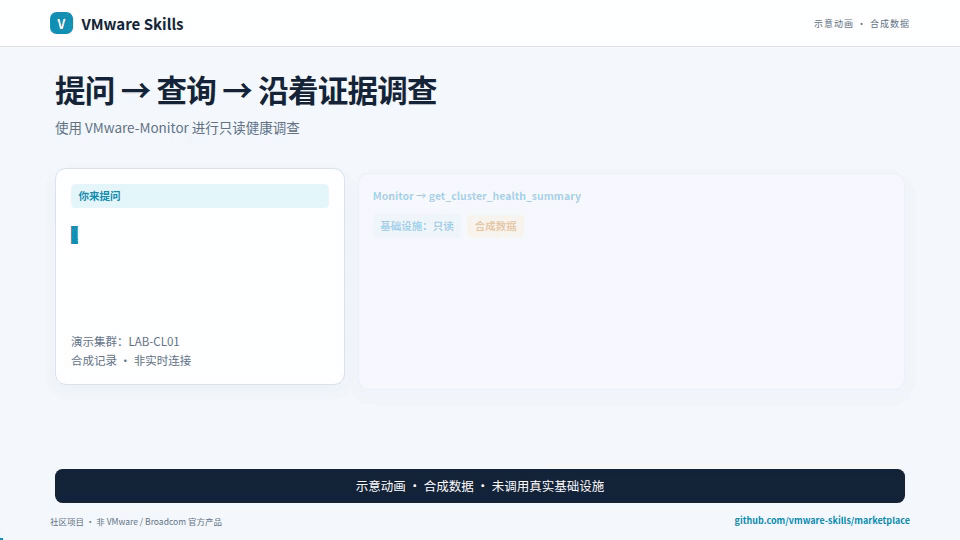
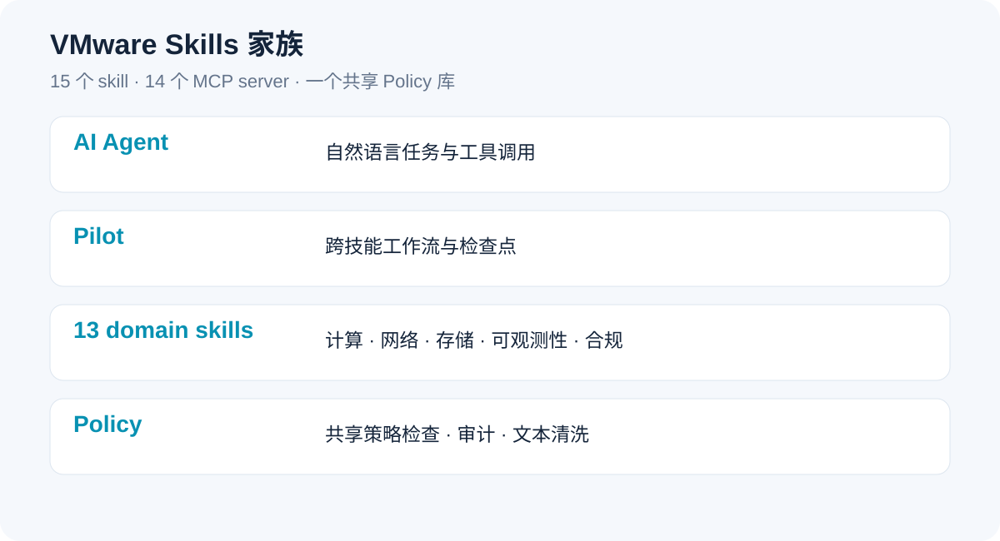

# VMware Skills

AI 辅助 VMware 运维：提一个问题，沿着证据调查，再规划下一步。从只读 Monitor 开始，按需增加专业模块。

[English](README.md) · 简体中文

**15 个 skill · 14 个 MCP server · 一个共享 Policy 库。** 社区维护，MIT 开源，非 VMware、Broadcom 或 Omnissa 官方产品。

[](https://github.com/vmware-skills/marketplace/releases/download/demos-2026-11-13-model-fit/vmware-skills-zh.mp4)

GIF 为合成数据；视频含脱敏的历史截图，详见[视频说明](assets/demos/README-CN.md)。

[下载配音介绍（约 3 分钟）](https://github.com/vmware-skills/marketplace/releases/download/demos-2026-11-13-model-fit/vmware-skills-zh.mp4) · [下载字幕](assets/demos/vmware-skills-zh.srt)

如果项目对你有用，欢迎 **Star 这个家族门户**，帮助更多人发现它。

## 它能帮我做什么？

- **找到需要关注的对象**：集群健康、告警、快照、存储及周边事件。
- **沿着证据调查**：关联 VM、主机和数据存储观测，明确保留证据缺口。
- **规划运维工作流**：通过专业模块完成评估、复核、执行与验证。

## 先装一个只读模块

在 Claude Code 中添加市场并安装 Monitor：

```text
/plugin marketplace add vmware-skills/marketplace
/plugin install vmware-monitor@vmware-skills
```

需要 Claude Code、Python 3.10+ 和 uv/uvx；PrivateAI 需要 Python 3.11+。各插件保留对应组件的固定版本运行配置。真实目标和凭据按照 [Monitor 配置指南](https://github.com/vmware-skills/VMware-Monitor/blob/main/skills/vmware-monitor/references/setup-guide.md)保存在本地；安装不代表已经连接。Pilot 还需要所执行工作流对应的 MCP 可执行程序。

<details>
<summary>可选：安装全部插件</summary>

克隆本仓库后，一条命令安装目录中的全部 15 个插件：

```sh
bash scripts/install-plugins.sh --all
```

可先加 --dry-run 查看命令。不带 --all 时只安装 Monitor。脚本调用 Claude Code 的市场/插件安装命令，不跳过信任提示，也不是适用于任意 Agent 的通用安装器。安装全部模块会暴露更多工具，各模块仍需分别配置。

</details>

<details>
<summary>Cursor、Codex、Gemini CLI、Cline 与本地模型宿主</summary>

[宿主配置指南](docs/agent-hosts-CN.md) 提供可复制的 JSON/TOML 示例与配置位置，无需 Claude Code 插件市场。先在本机配置目标，再验证一次只读查询。

</details>

## 家族如何协作



Pilot 负责工作流编排，13 个领域 skill 处理专业任务；Policy 是服务共用的治理库，不是独立 MCP server。15 个组件仓库继续独立维护版本。

| 组件 | 插件 | 用途 |
|---|---|---|
| [VMware-Monitor](https://github.com/vmware-skills/VMware-Monitor) | `vmware-monitor` | 只读健康、清单、告警及证据调查 |
| [VMware-AIops](https://github.com/vmware-skills/VMware-AIops) | `vmware-aiops` | 虚拟机生命周期、部署、Guest 操作与计划 |
| [VMware-Aria](https://github.com/vmware-skills/VMware-Aria) | `vmware-aria` | 指标、告警、容量及规格建议 |
| [VMware-NSX](https://github.com/vmware-skills/VMware-NSX) | `vmware-nsx` | 网络、网关、NAT、BGP 与 IPAM |
| [VMware-NSX-Security](https://github.com/vmware-skills/VMware-NSX-Security) | `vmware-nsx-security` | 防火墙策略、安全组、Traceflow 与 IDPS |
| [VMware-Storage](https://github.com/vmware-skills/VMware-Storage) | `vmware-storage` | 数据存储、iSCSI 与 FC/设备路径诊断 |
| [VMware-VKS](https://github.com/vmware-skills/VMware-VKS) | `vmware-vks` | Supervisor、命名空间与 Kubernetes 生命周期 |
| [VMware-AVI](https://github.com/vmware-skills/VMware-AVI) | `vmware-avi` | 负载均衡、资源池、服务引擎与 AKO |
| [VMware-Harden](https://github.com/vmware-skills/VMware-Harden) | `vmware-harden` | 合规扫描、漏洞证据与配置漂移 |
| [VMware-Debug](https://github.com/vmware-skills/VMware-Debug) | `vmware-debug` | 离线事件时间线与证据关联 |
| [VMware-Log-Insight](https://github.com/vmware-skills/VMware-Log-Insight) | `vmware-log-insight` | 只读日志搜索、聚合与突增调查 |
| [VMware-VDI](https://github.com/vmware-skills/VMware-VDI) | `vmware-vdi` | Horizon 桌面池、会话、机器与镜像 |
| [VMware-PrivateAI](https://github.com/vmware-skills/VMware-PrivateAI) | `vmware-privateai` | GPU/vGPU 就绪检查、配置与 PAIS 查询 |
| [VMware-Pilot](https://github.com/vmware-skills/VMware-Pilot) | `vmware-pilot` | 多步骤工作流、检查点与结果验证 |
| [VMware-Policy](https://github.com/vmware-skills/VMware-Policy) | `vmware-policy` | 共享治理库与 vmware-audit CLI；无独立 MCP server |

## 证据、权限与本地数据

Monitor 不修改 VMware 基础设施，但仍可能在本地写入配置、审计日志及导出报告；可选 daemon/webhook 行为见配置指南。其他模块包含写操作。VMware RBAC 与本地 Policy 继续生效。破坏性工具有预览/确认门，但调用者提供的确认参数不是独立人工审批；回滚只能尽力执行。保持 TLS 校验开启。

可使用根目录共享的[模型适配自测任务](MODEL_FIT_SELF_TEST.md)，验证模型与 Agent 宿主的只读任务质量。能力范围与真机兼容性以各组件文档记录为准；包可下载、演示可观看，不等于已验证某个平台。

选模型可用[共享模型自测流程](https://github.com/vmware-skills/marketplace/blob/main/model-fit/RUNNER-CN.md)：统一任务、复核质量与安全，再按任务组选择最小已测通过配置；不代表生产质量保证。

## 演示、反馈与社区

- [英文配音视频](https://github.com/vmware-skills/marketplace/releases/download/demos-2026-11-13-model-fit/vmware-skills-en.mp4) · [中文配音视频](https://github.com/vmware-skills/marketplace/releases/download/demos-2026-11-13-model-fit/vmware-skills-zh.mp4)
- [复现动画与配音素材](media/vmware-skills-demo/README.md)。
- [反馈问题或建议](https://github.com/vmware-skills/marketplace/issues)；具体组件缺陷请提交到对应仓库。
- GitHub：https://github.com/vmware-skills · MIT 许可。
