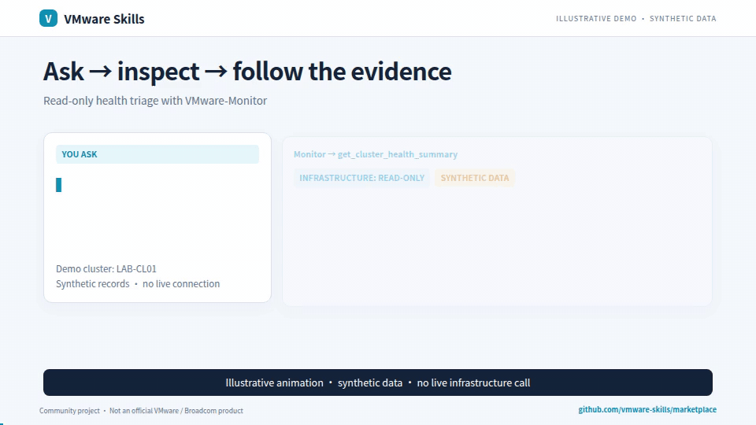
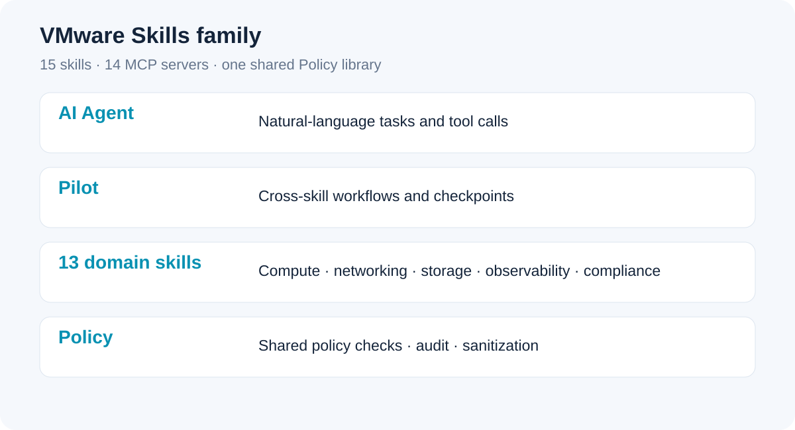

# VMware Skills

AI-assisted VMware operations: ask a question, investigate the evidence, and plan the next step. Start with read-only Monitor; add focused modules when needed.

English · [简体中文](README-CN.md)

**15 skills · 14 MCP servers · one shared Policy library.** Community-maintained, MIT-licensed, and not an official VMware, Broadcom or Omnissa product.

[](assets/demos/vmware-skills-en.mp4)

**The GIF uses synthetic data.** The narrated video also shows redacted excerpts from historical usage screenshots, including an assistant-prepared summary of exported audit records. Each source type is labeled; the video is not a new live test. English and Chinese videos use matching-language captures, with enlarged transcripts for dense logs. Watch at 1080p for table detail.

[Watch the narrated introduction (~2 minutes)](assets/demos/vmware-skills-en.mp4) · [Download captions](assets/demos/vmware-skills-en.srt)

Narration uses an AI-generated preset voice, not a recording of the maintainer. If the project helps your work, **star this family portal** so others can find it.

## What can I do with it?

- **Find what needs attention:** cluster health, alarms, snapshots, storage and surrounding events.
- **Investigate with evidence:** connect VM, host and datastore observations; keep missing evidence visible.
- **Plan operational workflows:** assess, review, execute and verify across focused modules.

## Start with one read-only module

In Claude Code, add the marketplace and install Monitor:

```text
/plugin marketplace add vmware-skills/marketplace
/plugin install vmware-monitor@vmware-skills
```

Requires Claude Code, Python 3.10+ and uv/uvx. PrivateAI requires Python 3.11+. Each plugin retains its component’s pinned runtime configuration. Configure real targets and credentials locally using the [Monitor setup guide](https://github.com/vmware-skills/VMware-Monitor/blob/main/skills/vmware-monitor/references/setup-guide.md); installation alone does not establish a connection. Pilot also needs the companion MCP executables for the workflows you run.

<details>
<summary>Optional: install the entire plugin catalog</summary>

After cloning this repository, run one command to install all 15 catalog entries:

```sh
bash scripts/install-plugins.sh --all
```

Use --dry-run to inspect the commands first. Without --all, the helper installs only Monitor. It delegates marketplace and plugin installation to Claude Code without bypassing trust prompts; this is not a new installer for arbitrary agents. All-module installation exposes more tools and requires separate module configuration.

</details>

## How the family fits together



Pilot coordinates workflows; 13 domain skills handle focused tasks; Policy is a shared library used by the servers, not a standalone MCP server. The 15 repositories remain independently versioned.

| Component | Plugin | Purpose |
|---|---|---|
| [VMware-Monitor](https://github.com/vmware-skills/VMware-Monitor) | `vmware-monitor` | Read-only health, inventory, alarms and evidence-based investigation |
| [VMware-AIops](https://github.com/vmware-skills/VMware-AIops) | `vmware-aiops` | VM lifecycle, deployment, guest operations and plans |
| [VMware-Aria](https://github.com/vmware-skills/VMware-Aria) | `vmware-aria` | Metrics, alerts, capacity and rightsizing |
| [VMware-NSX](https://github.com/vmware-skills/VMware-NSX) | `vmware-nsx` | Networking, gateways, NAT, BGP and IPAM |
| [VMware-NSX-Security](https://github.com/vmware-skills/VMware-NSX-Security) | `vmware-nsx-security` | Firewall policies, groups, Traceflow and IDPS |
| [VMware-Storage](https://github.com/vmware-skills/VMware-Storage) | `vmware-storage` | Datastores, iSCSI and FC/device-path diagnostics |
| [VMware-VKS](https://github.com/vmware-skills/VMware-VKS) | `vmware-vks` | Supervisor, namespaces and Kubernetes lifecycle |
| [VMware-AVI](https://github.com/vmware-skills/VMware-AVI) | `vmware-avi` | Load balancing, pools, service engines and AKO |
| [VMware-Harden](https://github.com/vmware-skills/VMware-Harden) | `vmware-harden` | Compliance scans, vulnerability evidence and drift |
| [VMware-Debug](https://github.com/vmware-skills/VMware-Debug) | `vmware-debug` | Offline incident timelines and evidence correlation |
| [VMware-Log-Insight](https://github.com/vmware-skills/VMware-Log-Insight) | `vmware-log-insight` | Read-only log search, aggregation and spike investigation |
| [VMware-VDI](https://github.com/vmware-skills/VMware-VDI) | `vmware-vdi` | Horizon pools, sessions, machines and images |
| [VMware-PrivateAI](https://github.com/vmware-skills/VMware-PrivateAI) | `vmware-privateai` | GPU/vGPU readiness, profiles and PAIS queries |
| [VMware-Pilot](https://github.com/vmware-skills/VMware-Pilot) | `vmware-pilot` | Multi-step workflows, checkpoints and verification |
| [VMware-Policy](https://github.com/vmware-skills/VMware-Policy) | `vmware-policy` | Shared governance library and vmware-audit CLI; no MCP server |

## Evidence, permissions and local data

Monitor does not mutate VMware infrastructure. It can still write local configuration, audit logs and exported reports; optional daemon/webhook behavior is documented in its setup guide. Other modules include writes. Existing VMware RBAC and local Policy still apply. Destructive tools have preview/confirmation gates, but a caller-supplied confirmation flag is not independent human approval. Rollback is best effort. Keep TLS verification enabled.

Use the shared [model-fit self-test](MODEL_FIT_SELF_TEST.md) to validate a read-only task with your model and agent host. Scope and real-environment compatibility are recorded in each component’s documentation; availability of a package or a demo is not a live-platform validation claim.

## Demos, feedback and community

- [English narrated video](assets/demos/vmware-skills-en.mp4) · [Chinese narrated video](assets/demos/vmware-skills-zh.mp4)
- [Reproduce the animations and audio](media/vmware-skills-demo/README.md).
- [Share an issue or suggestion](https://github.com/vmware-skills/marketplace/issues). Component bugs belong in the relevant component repository.
- GitHub: https://github.com/vmware-skills · MIT license.
